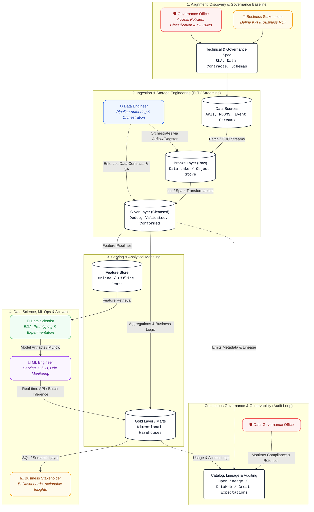

# Data Engineering Lifecycle & Governance Matrix

This repository documents the end-to-end **Data Engineering Lifecycle (DELC)**, defining core stages, stage gates, deliverables, and role responsibilities across the data organization.

---

## 1. Lifecycle Overview

The lifecycle transforms raw, disparate data into reliable business intelligence and production-grade machine learning systems through five main stages:

```
[ 1. Ingestion ] ➔ [ 2. Transformation & Storage ] ➔ [ 3. Serving & Analysis ] ➔ [ 4. Model Dev & Deployment ] ➔ [ 5. Monitoring & Maintenance ]
       ▲                          ▲                             ▲                           ▲                              ▲
       └──────────────────────────┴─────────────────────────────┴───────────────────────────┴──────────────────────────────┘
                                          Data Governance & Compliance Loop
```

---

## 2. Roles & Core Responsibilities

| Role | Primary Mandate |
| :--- | :--- |
| **Business Stakeholder** | Defines business objectives, success criteria, KPIs, and validates return on investment (ROI). |
| **Data Governance Office (DGO)** | Establishes policies, classification standards, access controls, compliance (GDPR/HIPAA), and data quality baselines. |
| **Data Engineer (DE)** | Designs and maintains scalable ingestion, data pipelines, warehousing/lakehouse architecture, and data contracts. |
| **Data Scientist (DS)** | Conducts exploratory data analysis (EDA), generates analytical features, builds statistical models, and benchmarks model prototypes. |
| **Machine Learning Engineer (MLE)** | Productionalizes ML models, designs real-time and batch inference pipelines, monitors feature drift, and automates CI/CD/CT (MLOps). |

---

## 3. Lifecycle Stages & RACI Matrix

> **Legend:**
> - **R** – Responsible (The doer)
> - **A** – Accountable (The final decision maker/approver)
> - **C** – Consulted (Provides two-way input)
> - **I** – Informed (Kept updated on progress)

### Stage 1: Problem Definition & Data Sourcing
* **Objective:** Identify the business need, evaluate feasibility, locate target data sources, and establish privacy/access clearance.
* **Stage Gate:** Signed Project Charter & Approved Data Access Request.

| Task / Deliverable | Stakeholder | DGO | DE | DS | MLE |
| :--- | :---: | :---: | :---: | :---: | :---: |
| Define business problem, KPIs, & SLA targets | **A / R** | C | C | C | I |
| Data classification, compliance, and access approval | I | **A / R** | C | C | I |
| Source identification, schema discovery, & volume estimation | C | C | **R** | C | I |
| Data contract drafting & source validation | I | C | **A / R** | I | I |

---

### Stage 2: Ingestion, Storage & Cleansing
* **Objective:** Extract data from upstream sources, land it securely, and implement bronze/silver-layer transformations.
* **Stage Gate:** Ingestion pipeline passing CI tests with automated schema validation and initial data-quality checks.

| Task / Deliverable | Stakeholder | DGO | DE | DS | MLE |
| :--- | :---: | :---: | :---: | :---: | :---: |
| Ingestion pipeline implementation (Batch / Streaming) | I | I | **A / R** | I | I |
| Lakehouse/Warehouse modeling (Bronze & Silver tiers) | I | C | **A / R** | C | I |
| Data lineage tracking & catalog registration | I | **A** | **R** | I | I |
| PII masking, tokenization, & encryption at rest/transit | I | **A** | **R** | I | I |

---

### Stage 3: Transformation, Feature Prep & Serving (Gold Layer)
* **Objective:** Model business dimensions, compute shared metrics, build feature stores, and establish curated consumption endpoints.
* **Stage Gate:** Gold data availability verified against data contracts and business logic acceptance tests.

| Task / Deliverable | Stakeholder | DGO | DE | DS | MLE |
| :--- | :---: | :---: | :---: | :---: | :---: |
| Business aggregation & metric layer implementation | C | I | **A / R** | C | I |
| Feature engineering logic & Feature Store population | I | I | **R** | **R** | C |
| Data quality testing (e.g., Great Expectations / Soda) | I | C | **A / R** | C | I |
| Analytical dashboard dataset sign-off | **A** | I | **R** | C | I |

---

### Stage 4: Modeling, Offline Training & Productionization
* **Objective:** Train statistical and ML models, establish model registries, and deploy inference pipelines to production.
* **Stage Gate:** Model review covering performance metrics, bias/fairness checks, and inference latency benchmarks.

| Task / Deliverable | Stakeholder | DGO | DE | DS | MLE |
| :--- | :---: | :---: | :---: | :---: | :---: |
| Exploratory Data Analysis (EDA) & hypothesis testing | I | I | I | **A / R** | C |
| Baseline model training & offline validation | C | I | I | **A / R** | C |
| Model packaging, containerization, & API deployment | I | I | C | C | **A / R** |
| Model bias, fairness, and ethical compliance review | I | **A / R** | I | C | C |
| CI/CD/CT pipeline configuration (MLOps) | I | I | C | I | **A / R** |

---

### Stage 5: Observability, Drift Detection & Maintenance
* **Objective:** Maintain pipeline health, verify data fresh-ness, detect model/data drift, and retire obsolete datasets/models.
* **Stage Gate:** Ongoing operational reviews and incident management SLAs.

| Task / Deliverable | Stakeholder | DGO | DE | DS | MLE |
| :--- | :---: | :---: | :---: | :---: | :---: |
| Business KPI tracking & ROI reporting | **A / R** | I | I | I | I |
| Data pipeline SLA, uptime, & cost monitoring (FinOps) | I | I | **A / R** | I | I |
| Model performance & feature/concept drift monitoring | I | I | I | C | **A / R** |
| Access permission audits & lifecycle retention (purge/archive) | I | **A / R** | **R** | I | I |

---

## 4. Best Practices & Quality Standards

1. **Data Contracts:** All upstream producer connections must adhere to agreed JSON schema or Protobuf contracts with version control.
2. **GitOps & CI/CD:** Pipeline definitions, infrastructure as code (IaC), and transformation queries (`dbt`, SQL, PySpark) must undergo peer review.
3. **Data Quality Gates:** Pipelines must break early on schema mismatch or non-null/uniqueness check failures before landing in Gold layers.
4. **Security by Default:** Zero Trust architecture; read access is strictly least-privilege, granted via role-based access control (RBAC) managed by DGO policies.